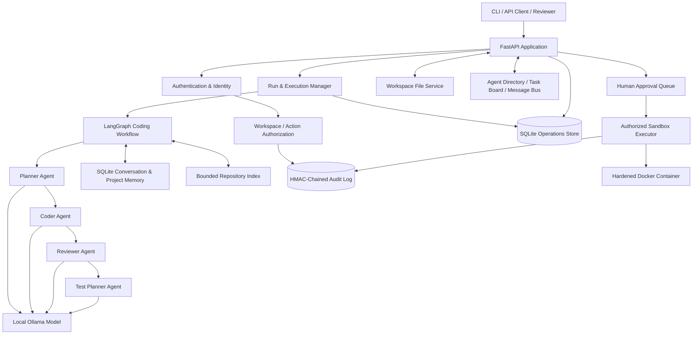
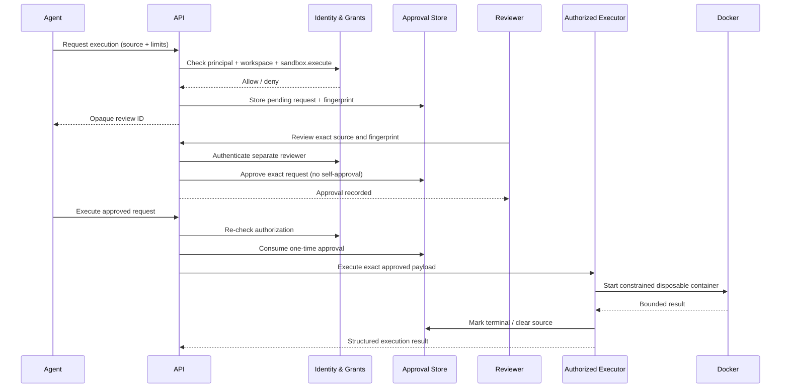

# AgenticOS — System Architecture

> **Documentation baseline:** Phase 15 implementation snapshot  
> **Branch:** `feature/phase-16-release-documentation`  
> **Status:** Phase 1–15 features are implemented on the documented development line and the Phase 15 head passed its GitHub Actions checks. Phase 16 is the integration, release-readiness, and documentation-validation phase. This document must be reconciled against the final integrated branch before release.

## 1. Product purpose

AgenticOS is a local-first, multi-agent coding platform. It accepts a coding task through a FastAPI service, coordinates a bounded workflow of specialist agents, uses a locally hosted Ollama model, optionally enriches the task with workspace memory and repository context, and exposes run progress and durable history.

The platform also provides controlled workspace file operations, agent collaboration primitives, persistent identity and workspace-scoped authorization, audit records, human approval for code execution, and an opt-in Docker sandbox.

**Important boundary:** AgenticOS is a coding assistant/runtime, not an unrestricted autonomous shell. Generated code is not automatically executed. Execution is a separate, opt-in workflow guarded by authorization and a one-time human approval.

## 2. High-level architecture

The diagram is a logical view. It does not imply that every component is a separate process or independently scalable service. In the current implementation these components run in one Python application process, with SQLite and Ollama as local dependencies; Docker is invoked only for the explicitly enabled sandbox path.

## 3. Main request lifecycle

1. **Ingress:** A client submits a task to `POST /v1/runs` or starts an asynchronous run through `POST /v1/runs/start`.
2. **Authentication:** API middleware authenticates configured operator credentials or a persisted identity token. Administrative routes require the separately configured identity-admin credential.
3. **Authorization and ownership:** The application derives the principal from the authenticated credential. Workspace actions and run/session access are checked against exact grants and ownership rules. Authorization is default-deny where a grant is required.
4. **Workspace validation:** Workspace identifiers and relative paths are resolved under the configured workspace root. Path validation is a useful application boundary, not an OS sandbox.
5. **Context assembly:** The application may load session history, workspace project notes, and repository search excerpts. Repository indexing is explicit and bounded; repository context is opt-in per run and must be treated as untrusted input.
6. **Agent workflow:** LangGraph executes the four coding roles in sequence: Planner → Coder → Reviewer → Test Planner. Each stage uses a role-specific system prompt and the configured model client.
7. **Progress and cancellation:** Stage updates and streamed model chunks are surfaced through the run manager. A run has a generated ID, lifecycle state, configured timeout, concurrency bound, and cancellation handling.
8. **Persistence:** Run snapshots/checkpoints and bounded lifecycle events are written to SQLite stores. Session conversation and project context are persisted by the memory store.
9. **Response:** The API returns the run result or an accepted run identifier, depending on the endpoint. Clients can inspect status and resume event consumption using event IDs.

## 4. Agent workflow

| Role | Responsibility | Output |
|---|---|---|
| Planner | Break down the user request and identify constraints | Structured implementation plan |
| Coder | Produce a proposed solution based on the plan | Code and implementation explanation |
| Reviewer | Inspect the proposed solution for correctness and risks | Review findings and changes to consider |
| Test Planner | Propose validation cases and test coverage | Test plan |

The current workflow is deliberately sequential. Collaboration primitives (agent directory, task board, dependency-aware readiness, and bounded message bus) provide a foundation for delegation and coordination, but they should not be confused with a distributed agent cluster. The default coding workflow remains the four-stage graph.

## 5. Runtime and inference

- `CodingWorkflow` orchestrates the graph and emits stage/token progress.
- `ExecutionManager` owns run lifecycle, concurrency, timeout, cancellation, checkpoints, and event persistence.
- `OllamaClient` implements the model-client interface using the configured local Ollama HTTP endpoint.
- Default model: `qwen2.5-coder:3b`; configurable through environment settings.
- There is no hosted model-provider fallback in the documented configuration.
- Streaming uses bounded run-scoped Server-Sent Events; non-streaming inference remains supported.

## 6. Memory and repository context

### Conversation and project memory

The SQLite memory layer stores session messages and workspace-scoped project notes. Memory context is assembled for a run and passed to the workflow as additional context. Session IDs are identifiers, not authentication credentials; access still depends on authenticated principal and ownership checks.

### Repository index

The repository index scans a bounded set of eligible text files and supports local keyword/SQLite FTS5 search. It excludes hidden, binary, oversized, and dependency/cache content. Indexing is explicitly requested and must be refreshed after relevant file changes. Search results are excerpts, not trusted instructions; they must be treated as untrusted reference data.

## 7. Workspace operations

The workspace service supports bounded file listing, UTF-8 text reads, staged writes, pending-change review, approval, and rejection. File paths are resolved beneath the configured workspace root. Staged changes are not applied until explicitly approved.

This path boundary does not provide process isolation. It does not make arbitrary code safe to run, and it does not replace OS permissions or the Docker sandbox.

## 8. Collaboration subsystem

The collaboration package contains:
- **AgentDirectory:** registers agent profiles and selects an agent for a task based on declared capabilities.
- **TaskBoard:** stores tasks, dependencies, assignment, readiness, and lifecycle transitions.
- **AgentMessageBus:** delivers bounded in-process messages to registered agents.
- **AgentCoordinator:** façade for registration, delegation, task transitions, and message operations.

These are in-process primitives in the current architecture; no distributed broker or cross-host coordination guarantee is claimed.

## 9. Durable state and storage

| Store | Purpose | Durability / boundary |
|---|---|---|
| Memory SQLite DB | Session messages and workspace project notes | Local persistent file |
| Repository index | Bounded local text-file index | Refreshable local index |
| Operations SQLite DB | Run checkpoints, lifecycle events, identities, grants, and API/security audit data as configured | Local persistent file |
| Approval SQLite DB | Pending human review requests and approval lifecycle metadata | Local persistent file; sensitive source is cleared at terminal transitions |
| Audit HMAC key file | Authenticates audit-chain events | Separate local key file in private data directory |
| Ollama model store | Local model weights and inference runtime | Managed by Ollama |
| Docker image cache | Approved sandbox image by immutable digest | Preloaded by operator; runtime does not pull |

SQLite files and sidecars are hardened with restrictive permissions where supported. POSIX deployment expects a private service-owned directory; Windows requires explicit NTFS ACLs. A local filesystem and host administrator remain part of the trust boundary.

## 10. Identity, authorization, and audit

- Principals have stable identifiers and enabled/disabled state.
- Bearer tokens are generated with high entropy; only SHA-256 verifiers are stored for managed tokens.
- Tokens can be issued, rotated, revoked, disabled by principal state, and expired. Managed token TTL defaults to 30 days and is bounded to 90 days.
- A separate bootstrap administrator credential enables identity-management routes; it is configuration-managed and distinct from operator credentials.
- Grants are exact action/resource pairs scoped to a principal and workspace. Unmatched requests are denied.
- Run, session, workspace, and tool access enforce authenticated ownership and relevant workspace grants.
- Security audit events are canonicalized and HMAC-SHA256 chained with sequence numbers and previous-event digests. SQLite triggers reject ordinary updates/deletes.
- An administrator-only integrity endpoint verifies the chain and can compare its head to an independently retained checkpoint.

A local SQLite chain cannot detect deletion of its newest tail without an independently stored checkpoint. The current local key-file protection does not defend against a compromised service account or host administrator.

## 11. Human-approved sandbox execution

Sandbox execution is disabled unless explicitly configured. The approved flow is:

Container controls include a digest-pinned preloaded image, no network, read-only root filesystem, non-root UID/GID, dropped capabilities, no-new-privileges, PID/CPU/memory limits, bounded tmpfs, read-only source mount, output/log bounds, timeout handling, and cleanup. The backend does not pull images automatically and has no host-shell fallback.

**Trust boundary:** Docker daemon, container runtime, host kernel, host administrator, and service account remain trusted. This is defense in depth, not a guarantee against container or kernel escapes. Stronger isolation (for example, a microVM) may be required for hostile multi-tenant workloads.

## 12. API surface map

The API is grouped into these route families (see [API Reference](api-reference.md) for the route inventory):

- Health/readiness and current identity
- Run creation, start, status, cancellation, event history, and SSE streaming
- Session history and workspace project context
- Repository indexing and search
- Workspace file read/list and staged-change review
- Tool execution under authenticated workspace grants
- Identity administration and audit verification
- Sandbox review, approval, and execution

## 13. Configuration and deployment model

Configuration is loaded from environment variables / `.env` using typed settings. The main dependencies are Python 3.11+, FastAPI, LangGraph, Pydantic Settings, Uvicorn, and a local Ollama service. SQLite is used for local persistence. Docker is optional and only required when the sandbox is enabled.

See:
- [Operations Runbook](operations-runbook.md)
- [Security Model](security-model.md)
- [Testing and CI](testing-and-ci.md)
- [API Reference](api-reference.md)

## 14. Current implementation boundaries and known limitations

1. Single-process application architecture; no distributed scheduler, broker, or multi-node coordination.
2. Local Ollama dependency; no hosted model failover.
3. SQLite is suitable for the current local-first footprint, not a claim of high-availability distributed persistence.
4. Repository search is local keyword/FTS5 search, not semantic retrieval.
5. Repository context and project notes are untrusted data and can contain prompt injection.
6. Workspace path validation is not an OS sandbox.
7. Docker sandbox trusts the daemon and host kernel; it is not a perfect isolation guarantee.
8. Audit tail deletion detection requires an independently retained chain-head checkpoint.
9. Audit key rotation and automated external checkpoint retention remain follow-up operational controls.
10. No external identity provider, SSO, centralized secrets manager, or distributed authorization service is implemented.
11. The current architecture and docs must be reconciled with the final Phase 16 integrated commit before release.

## 15. Phase 16 architecture validation

Before release, verify on the integrated `dev` branch:
- Every module and route described here exists and is wired in the application.
- The documented storage paths and environment variables match the final settings model.
- Full CI and Docker integration checks pass against the exact integration commit.
- Setup commands work from a clean checkout.
- Security and operational limitations remain explicit.
- The diagram reflects the final runtime and no planned-but-unimplemented component is presented as complete.
